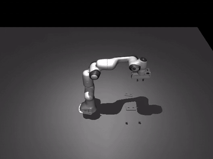
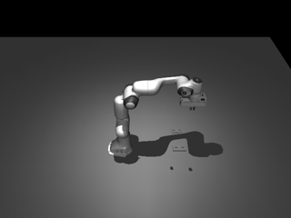
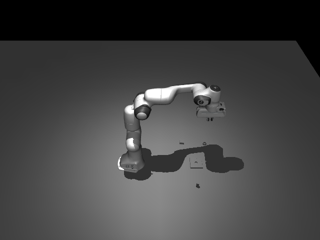

# Supermimic YAI

Yet Another Implementation of [SuperMimic: Scaling Humanoid Whole-Body Control with One Differentiable World Model](https://arxiv.org/abs/2610.28480) (Liao et al., CoRL 2026).

- `wiki/` — paper notes, a git submodule pointing at a private repo (`joreb/supermimic-wiki`). Collaborators with access: `git submodule update --init`.
- `src/supermimic_yai/` — implementation (work in progress).

## Demo: Product A assembled by scripted action tokens



Scripted baseline (Plan 1), seed 0, played at 2x. Full-length video: [media/product_a.mp4](media/product_a.mp4). The learned SuperMimic-style controller replaces the contact tokens in Plan 2.

## Docker

All tests run in the image (CPU, MuJoCo with OSMesa rendering):

```
docker build -t supermimic-yai .
docker run --rm -v "$PWD":/work -w /work supermimic-yai pytest -q
```

## Run a recipe

Execute a hand-written token recipe on a product and score the result (exit code 0 on success, 1 on failure, 2 on an invalid recipe):

```
docker run --rm -v "$PWD":/work -w /work supermimic-yai \
  python -m supermimic_yai.cli run-recipe products/product_a recipes/product_a.json --seed 0 --video out/product_a.mp4
```

Locally installed, the same command is `supermimic run-recipe ...`. Reference recipes for products A, B and C live in `recipes/`; `pytest -m slow` checks that each succeeds on at least 8 of 10 seeds.

## Train

Dyna-style training of the learned controller from the Plan 2a world model (`--init` dir holds `episodes.npz` and `model.pt`). B and C are held out: never trained on, only evaluated. `--arm` is required; `--set key=val` overrides any config value. On the laptop GPU (GTX 1050, 4 GB) use `--set train.episodes_per_iter=8`.

```
docker run --rm --gpus all -v "$PWD":/work -w /work supermimic-yai \
  python -m supermimic_yai.train --config laptop --arm arms/panda --init runs/wm \
  --products products/product_a --heldout products/product_b products/product_c \
  --bank runs/wm/bank.npz --eval-banks runs/eval/bank_a.npz runs/eval/bank_b.npz runs/eval/bank_c.npz \
  --iters 200 --set train.episodes_per_iter=8
```

Add `--resume` to continue from the last checkpoint. Watch curves and eval videos in a second container:

```
docker run --rm -p 6006:6006 -v "$PWD":/work -w /work supermimic-yai \
  tensorboard --logdir runs --bind_all --port 6006
```

then open http://localhost:6006.

## Evaluate

Per-token and full-recipe success on EVAL seeds for products A, B and C; `--controller scripted` gives the baseline column (PLACE and PRESS are scripted in every table).

```
docker run --rm --gpus all -v "$PWD":/work -w /work supermimic-yai \
  python tools/eval.py --actor runs/train/actor.npz --seeds 20
```

Learned kinds default to the ones stored in the actor file (a trained `actor.npz`: GRASP, ALIGN and INSERT; the older `runs/bc/actor.npz`: GRASP only, as is any actor saved before this field existed, e.g. `runs/train9/actor.npz`, which needs `--learned-kinds GRASP ALIGN INSERT`); `--learned-kinds` overrides, and the table's controller column says which kinds ran learned. Results land in `runs/eval/results.md`.

## Watch live

Open a MuJoCo window (WSLg) that follows the recipe in real time. Without `DISPLAY`/`WAYLAND_DISPLAY` the command exits 2.

```
docker run --rm --gpus all -e DISPLAY -e WAYLAND_DISPLAY -e XDG_RUNTIME_DIR \
  -v /tmp/.X11-unix:/tmp/.X11-unix -v /mnt/wslg:/mnt/wslg -v "$PWD":/work -w /work supermimic-yai \
  python -m supermimic_yai.cli run-recipe products/product_a recipes/product_a.json --arm arms/panda --viewer
```

Add `--controller learned --actor runs/train/actor.npz` to watch the trained policy: the kinds stored in the actor file run learned (for a trained actor, GRASP, ALIGN and INSERT; PLACE and PRESS stay scripted), the rest scripted; each step line is tagged `[learned]` or `[scripted]`. `--learned-kinds` overrides; actors saved before the stored-kinds field (e.g. `runs/train9/actor.npz`) load as GRASP-only, so pass `--learned-kinds GRASP ALIGN INSERT` for them. Rebuild the image once (`docker build -t supermimic-yai .`) to pick up `libglfw3`.

## Results

Laptop run (GTX 1050, 4 GB): `train` command above with `--iters 1000 --set train.episodes_per_iter=8`, logdir `runs/train9`, killed at the 12 h wall-clock cap (SIGKILL after `docker stop`, so no final save; fixed since in d134670: SIGTERM now saves a final checkpoint, so `--resume` loses nothing; about 12 h wall-clock, 1189 MiB GPU memory). The last checkpoint is iteration 450. Evaluation: `tools/eval.py --seeds 50` on EVAL seeds, learned kinds GRASP/ALIGN/INSERT (passed explicitly as `--learned-kinds GRASP ALIGN INSERT`; the runs/train9 actors predate the stored-kinds field). Per-token rows use 50 start states from the 20-seed EVAL banks (C ALIGN has 48); full-recipe rows use 50 EVAL seeds; PLACE and PRESS are scripted in every column. "BC" is the behaviour-cloning warm start (`actor_bc.npz`), "trained" is the final Dyna-trained actor.

| product | token | scripted | BC | trained |
|---|---|---|---|---|
| A | GRASP | 1.00 | 0.64 | 0.00 |
| A | ALIGN | 1.00 | 0.64 | 0.00 |
| A | INSERT | 0.98 | 0.62 | 0.00 |
| A | PLACE, PRESS | scripted | scripted | scripted |
| A | **full recipe** | 0.98 | 0.00 | 0.00 |
| B | GRASP | 1.00 | 0.40 | 0.00 |
| B | ALIGN | 1.00 | 0.28 | 0.00 |
| B | INSERT | 1.00 | 0.26 | 0.00 |
| B | PLACE, PRESS | scripted | scripted | scripted |
| B | **full recipe** | 0.90 | 0.00 | 0.00 |
| C | GRASP | 0.98 | 0.22 | 0.00 |
| C | ALIGN | 1.00 | 0.08 | 0.00 |
| C | INSERT | 0.76 | 0.14 | 0.00 |
| C | PLACE, PRESS | scripted | scripted | scripted |
| C | **full recipe** | 0.46 | 0.00 | 0.00 |

**Outcome against targets: missed.** Product A full-recipe success is 0 % for the learned controllers (target 80 %); held-out B and C are 0 % (target 50 %). `eval/recipe_success` for A stayed at 0 throughout training, so the plateau rule never fired. The BC warm start (2000 iterations shared over GRASP, ALIGN and INSERT, so lower than the GRASP-only actor of the earlier BC task; not re-run) is the best learned actor (A tokens 62-64 %, B 26-40 %, C 8-22 %) and Dyna updates made it worse: trained-actor token success is 0 % everywhere (A GRASP peaked at 13 % at iteration 300, then fell). Likely causes, not separated by an experiment: issue #6 (the imagination horizon H=32 at 50 Hz is shorter than a grasp, so imagined returns cannot credit a completed grasp) and world-model drift (below). Nothing in `src/` was retuned. The scripted baseline stays the only controller that finishes recipes (A 98 %, B 90 %, C 46 %; C INSERT is the weak token).

World model at the end (iteration 450): logged `wm/kstep_err_pt` is k=8 error on the replay window, not held-out: GRASP 0.7 mm at iteration 10 rising to 9.6 mm, ALIGN 29 mm, INSERT 24 mm, against about 1 mm in Plan 2a. `wm/loss` rose to 1.4e4. Likely cause: the world-model normalisation was fixed from Plan 2a scripted data and never refit as the replay shifted to learned-policy data (train.py). Not verified.

GIFs show the BC actor (the better learned actor) on seed 0: `media/learned_a.gif` (A), `media/learned_b.gif` (B). Neither completes the recipe.



